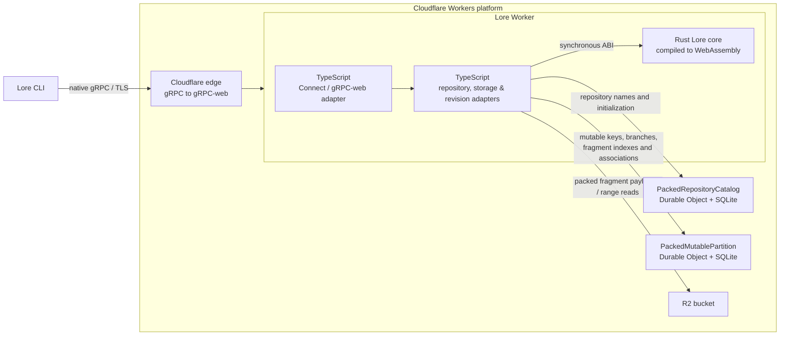

# Lore Worker spike

This is an incomplete, **unauthenticated** experiment. Anyone who can reach the
endpoint can read and modify its data; do not use it for real or sensitive
repositories. It is not a production server.

The isolated deployment is `lore-worker-mvp-spike` at
`grpcs://lore-mvp.gasparina.work`. Cloudflare's edge translates native gRPC to
gRPC-web for the Connect Fetch adapter. The packed-storage deployment is version
`7605e382-4940-4469-b8b5-2bc287743b98`, using bucket
`lore-worker-mvp-packs-20261104` and SQLite-backed Durable Object namespaces.
The earlier per-fragment deployment used bucket `lore-worker-mvp-spike-20261104`.

On 2026-11-04 the locally built unmodified Lore `0.12.1-nightly` CLI created and
listed a remote repository, staged and pushed two commits, then cloned it and
verified the file contents. That test used a loopback HTTP/2 bridge which
forwards native gRPC over TLS; Node verifies the upstream certificate. It does
not test Lore's own TLS stack. Direct `grpcs://` discovery was previously
verified by the user against the separate diagnostic, not against this MVP.
On 2026-11-05 the same bridged CLI probe passed against the packed-storage
deployment, including a push and clone of an 8 MiB fragmented file.

For an isolated test on a network where Lore can verify the TLS certificate,
run from a disposable working directory and use a unique repository name:

```sh
export LORE_ACCESS_TOKEN="$(node -e 'const b=x=>Buffer.from(JSON.stringify(x)).toString("base64url"); console.log(b({alg:"none"})+"."+b({sub:"tester",iss:"local",aud:"local",exp:4102444800})+".x")'"
lore --identity tester repository create grpcs://lore-mvp.gasparina.work/YOUR-UNIQUE-NAME
lore --identity tester repository list grpcs://lore-mvp.gasparina.work
# In the new repository's directory:
printf 'Hello from Lore on Workers.\n' > example.txt
lore --identity tester stage example.txt
lore --identity tester commit "initial commit"
lore --identity tester push
lore --identity tester clone grpcs://lore-mvp.gasparina.work/YOUR-UNIQUE-NAME /tmp/lore-clone
```

The example token only satisfies the CLI's local identity handling. The Worker
does not validate it or enforce permissions. The exact installed client version
and its TLS environment may behave differently.

## Architecture



The Worker routes API calls through Connect. SQLite transactions coordinate
repository names, mutable keys, branch-tip updates and pack indexes; R2 stores
fragment payloads. Reads use the indexed R2 byte range; metadata and queries use
SQLite without fetching payloads. The adapters call the shared Rust core in Wasm for fragment checks,
hashing, and metadata encoding and validation. Revision traversal and branch
operations are currently implemented in TypeScript. The loopback bridge used
by the probes is a test harness and is not part of the deployed architecture.

### Pack settings

Both Wrangler configs provide these per-stream settings:

| Variable | Default | Meaning |
| --- | --- | --- |
| `PACK_MAX_BYTES` | `104857600` (100 MiB) | Upper bound on packed payload bytes; 256 KiB–100 MiB. |
| `PACK_LINGER_MS` | `1000` | Maximum time to collect a partial pack before queueing it; 0–60000 ms. |
| `PACK_CONCURRENCY` | `50` | Maximum pack writes in flight; 1–1000. |
| `PACK_MAX_PENDING` | `1000` | Maximum unconsumed stream items, including completed responses; 1–10000. |

A pack also flushes at end of input or when the pending-item limit would stall
the stream. Linger limits batching delay, not the time waiting for an upload
slot or an acknowledgement. R2 storage and the SQLite index must both complete
before an item is acknowledged.

To bound per-stream memory, the writer retains at most approximately 32 MiB of
validated payloads, plus their concatenated upload buffers and runtime overhead;
it pauses input when the budget is full. It also limits each batch to the smaller
of `PACK_MAX_BYTES` and 32 MiB divided by `min(PACK_CONCURRENCY, 4)`. With the
defaults this means an **8 MiB effective pack limit**, despite the 100 MiB
configured maximum. This budget is per stream, not per isolate; concurrent
streams share the Workers 128 MB isolate limit. Cloudflare also queues outgoing
connections above its per-invocation limit, so a concurrency setting of 50 does
not mean 50 simultaneous R2 connections. Measure throughput and memory on the
target account before tuning these values.

## Reproduce the probes

From `contrib/cloudflare-grpc-spike/`, install Node with Zstd support, npm,
`protoc`, and Rust with the `wasm32-unknown-unknown` target. For the
CLI probe, build `target/debug/lore` with `cargo build --locked -p lore-client
--bin lore` at the workspace root. Protobuf generation uses this checkout's
`lore-proto` definitions; Wrangler compiles the portable Rust core automatically:

```sh
npm ci
npm run generate
npm run typecheck
node mutable-probe.mjs
node core-probe.mjs
node pack-failure-probe.mjs
node immutable-probe.mjs
node cli-probe.mjs
node cli-probe.mjs https://lore-mvp.gasparina.work
```

The remote CLI probe exercises the code currently deployed at the target URL;
run it against the packed version only after that version is deployed.

`npm run generate` creates protobuf JavaScript and TypeScript declarations;
`npm run typecheck` regenerates Cloudflare runtime and binding types from the
local Wrangler configuration, builds the Wasm core, and checks the Worker.
Re-run both commands after changing the relevant protobuf or Wrangler config.
To run the Worker locally after generating the protobuf files, use
`npx wrangler dev --local` from this directory.

Run local probes sequentially because Wrangler may choose the same internal
ports. They use temporary local state and remove it on exit. The remote probe
creates a uniquely named repository that remains in remote storage; deletion is
not implemented. Its bridge listens only on loopback.

The Rust compiler selected by Cargo must have the Wasm target installed. If a
different `rustc` appears earlier in `PATH`, set `RUSTC` to the target-enabled
compiler (for example, `export RUSTC="$(rustup which rustc)"`).

## Scope and limitations

Fragment ingress checks, content hashing and metadata buffer encoding and
validation use the same portable Rust code as native Lore through Wasm. The
Fetch/Connect, R2 and Durable Object adapters, Zstd decoding, revision graph
traversal and branch operations are TypeScript; this is not a complete
port of the Lore server or its revision semantics.

Implemented: discovery; repository create/get/list and metadata get; default
branch get/list/metadata get; limited single-parent fast-forward push; mutable
load/store/CAS; immutable put/get/get-metadata/query, resolved mappings and
same-repository copy. The revision checker verifies a limited current-format,
structural subset and fragmented file content, but is not a complete structural
or security validation of arbitrary Lore revision graphs. The probes cover a
missing reference, concurrent competing pushes and restart persistence, not all
malformed graphs or crash recovery scenarios.

The server advertises no compression; it accepts ordinary bounded Zstd frames
from clients and stores their hash-verified decompressed content. LZ4, Oodle,
Zstd dictionaries and checksums, fragmented structural revisions, merges, forced pushes,
cross-repository copy, locks, deletion, metadata CAS and most revision APIs are
unsupported. Larger files and other ordinary CLI operations may fail.

Pack objects are stored in R2 before their index and associations are atomically
published in the repository Durable Object. An item is acknowledged only after
both writes succeed; retries are safe, though failed or conflicting writes can
leave unreachable pack objects. Repository
names remain reserved after interrupted initialization until the same request
retries. Garbage collection, lifecycle management and safe deletion are not
implemented.

The packed deployment uses a separate bucket and Durable Object namespaces;
repositories from the earlier namespaces are not automatically migrated. The
previous bucket and namespaces are not deleted. Local probes cover a 5,000-leaf
logical file, and the bridged remote CLI probe covers an 8 MiB fragmented file;
a 1.5 GB remote upload has not been tested. Cloudflare's
[request-body limits](https://developers.cloudflare.com/workers/platform/limits/#request-and-response-limits)
depend on the domain plan and apply independently of pack size; a single large
gRPC stream can exceed them. CPU and per-request subrequest limits also apply,
especially to long-lived streams and per-fragment reads. Remote throughput and
large-file behavior remain to be measured.
The remote config requests a 50,000-subrequest budget. The deployment accepted
the setting, but this probe did not exercise that many subrequests.

`wrangler.jsonc` is local-only. `wrangler.remote.jsonc` configures the isolated
remote deployment; from this directory, deploy with `CLOUDFLARE_ACCOUNT_ID`
set to the intended account:

```sh
npx wrangler deploy --config wrangler.remote.jsonc
```

If the Wasm build reports that it cannot find the `core` or `std` crate for
`wasm32-unknown-unknown`, check which `rustc` Cargo uses. When the target is
installed through rustup but another compiler is first on `PATH`, select the
rustup compiler for the deployment:

```sh
rustup target add wasm32-unknown-unknown
RUSTC="$(rustup which rustc)" npx wrangler deploy --config wrangler.remote.jsonc
```
