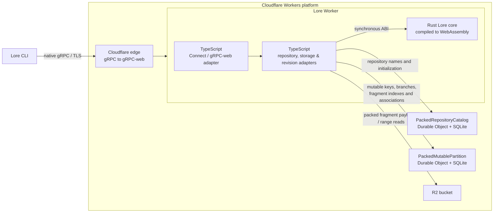

# Lore Worker spike

This is an incomplete, **unauthenticated** experiment. Anyone who can reach the
endpoint can read and modify its data; do not use it for real or sensitive
repositories. It is not a production server.

The isolated deployment is `lore-worker-mvp-spike` at
`grpcs://lore-mvp.gasparina.work`. Cloudflare's edge translates native gRPC to
gRPC-web for the Connect Fetch adapter. The packed-storage deployment uses bucket
`lore-worker-mvp-packs-20261104` and SQLite-backed Durable Object namespaces.
The earlier per-fragment deployment used bucket `lore-worker-mvp-spike-20261104`.

On 2026-11-04 the locally built unmodified Lore `0.12.1-nightly` CLI created and
listed a remote repository, staged and pushed two commits, then cloned it and
verified the file contents. That test used a loopback HTTP/2 bridge which
forwards native gRPC over TLS; Node verifies the upstream certificate. It does
not test Lore's own TLS stack. Direct `grpcs://` discovery was previously
verified by the user against the separate diagnostic, not against this MVP.
On 2026-11-05 the same bridged CLI probe passed against the packed-storage
deployment, including a push and clone of an 8 MiB fragmented file.
With the installed Lore `0.12.0+1967` client, a clean-data bridged clone of the
`seven` repository (1.41 GiB) completed in 324.32 seconds after several HTTP/2
stream resets and retries. This bridge-based result is not comparable to the
user's 197-second direct clone.
An experimental cross-batch range scheduler timed out after 400 seconds on the
same bridged clone. Its last progress snapshot at 372.6 seconds showed 17,127
responses, 2,368 R2 reads and 1,517,378,095 R2 bytes received, with no item or
R2 errors reported. The Worker was rolled back to version
`a32b9e27-f5d3-4db4-9502-5ac57a4385d7` for further experimentation.
Reducing the experimental maximum merged range from 8 MiB to 1 MiB also failed
to beat the baseline: the same clone timed out after 360 seconds. The Worker was
again rolled back to that baseline version.

The subsequent content-order repack experiment uploaded the 1.41 GiB
`idea-2026.2.1-aarch64.dmg` to repository
`probe-ed78d528-aff5-492b-9b9d-58fb11271a36`. Repacking moved 17,320 fragments
into 182 packs in approximately 291 seconds, reading 1,532,458,642 bytes from R2.
Clean-data clones using the installed `0.12.0+1967` client and a TLS-verifying
loopback bridge, with SHA-256 verification, produced these results:

| Bridge receive window | Client storage connections | R2 read concurrency per stream | Seconds | MiB/s |
| --- | --- | --- | ---: | ---: |
| 16 MiB | 1 | 6 | 142.77 | 10.10 |
| 16 MiB | 4 | 6 | 72.80 | 19.81 |
| 16 MiB | 8 | 6 | 70.20 | 20.55 |
| 16 MiB | 4 | 24 | 62.35 | 23.13 |
| 16 MiB | 4 | 64 | 65.28 | 22.10 |

These runs used the repacked repository, a 4 MiB maximum merged range and no
read-ahead. They are separate measurements, not controlled repetitions. Four
connections with 1 MiB read-ahead and a 4 MiB per-stream cache took 81.60 seconds.
An experiment allowing up to 4x overfetch with a 256 KiB gap took 70.77 seconds;
it was reverted. A two-connection run with a 5,461-item pending limit timed out
after 100 seconds; the 2,048-item limit was restored. Neither packing nor the bridge settings establish a direct-client
performance improvement, and the target of 50 MiB/s has not been reached.
In this test environment, the direct CLI fails to connect while the certificate
presented to OpenSSL is issued by the corporate TLS interception CA. The currently
deployed Worker is `cc2c2ecd-a4de-43d9-a0ba-6709f5c48908`.

For an isolated test on a network where Lore can verify the TLS certificate,
run from a disposable working directory and use a unique repository name:

```sh
export LORE_ACCESS_TOKEN="$(node -e 'const b=x=>Buffer.from(JSON.stringify(x)).toString("base64url"); console.log(b({alg:"none"})+"."+b({sub:"tester",iss:"local",aud:"local",exp:4102444800})+".x")'"
lore --identity tester repository create grpcs://lore-mvp.gasparina.work/YOUR-UNIQUE-NAME
lore --identity tester repository list grpcs://lore-mvp.gasparina.work
# In the new repository's directory:
printf 'Hello from Lore on Workers.\n' > example.txt
lore --identity tester stage example.txt
lore --identity tester commit "initial commit"
lore --identity tester push
lore --identity tester clone grpcs://lore-mvp.gasparina.work/YOUR-UNIQUE-NAME /tmp/lore-clone
```

The example token only satisfies the CLI's local identity handling. The Worker
does not validate it or enforce permissions. The exact installed client version
and its TLS environment may behave differently.

## Architecture



The Worker routes API calls through Connect. SQLite transactions coordinate
repository names, mutable keys, branch-tip updates and pack indexes; R2 stores
fragment payloads. Reads use the indexed R2 byte range; metadata and queries use
SQLite without fetching payloads. The adapters call the shared Rust core in Wasm for fragment checks,
hashing, and metadata encoding and validation. Revision traversal and branch
operations are currently implemented in TypeScript. The loopback bridge used
by the probes is a test harness and is not part of the deployed architecture.

### Pack settings

Both Wrangler configs provide these per-stream settings:

| Variable | Default | Meaning |
| --- | --- | --- |
| `PACK_MAX_BYTES` | `104857600` (100 MiB) | Upper bound on packed payload bytes; 256 KiB–100 MiB. |
| `PACK_LINGER_MS` | `1000` | Maximum time to collect a partial pack before queueing it; 0–60000 ms. |
| `PACK_CONCURRENCY` | `50` | Maximum pack writes in flight; 1–1000. |
| `PACK_MAX_PENDING` | `1000` | Maximum unconsumed stream items, including completed responses; 1–10000. |

A pack also flushes at end of input or when the pending-item limit would stall
the stream. Linger limits batching delay, not the time waiting for an upload
slot or an acknowledgement. R2 storage and the SQLite index must both complete
before an item is acknowledged.

To bound per-stream memory, the writer retains at most approximately 32 MiB of
validated payloads, plus their concatenated upload buffers and runtime overhead;
it pauses input when the budget is full. It also limits each batch to the smaller
of `PACK_MAX_BYTES` and 32 MiB divided by `min(PACK_CONCURRENCY, 4)`. With the
defaults this means an **8 MiB effective pack limit**, despite the 100 MiB
configured maximum. This budget is per stream, not per isolate; concurrent
streams share the Workers 128 MB isolate limit. Cloudflare also queues outgoing
connections above its per-invocation limit, so a concurrency setting of 50 does
not mean 50 simultaneous R2 connections. Measure throughput and memory on the
target account before tuning these values.

Fragmented content of at least 4 MiB is also repacked in logical content order
after publication through `PutResolved` or a successful branch push. This
walks the tree, assembles up to 8 MiB per output object, and conditionally moves
each index entry only if its old location is still current. The original packs
are retained, so reads that already resolved an old location can finish. Repack
errors are logged and do not prevent publication; completed pack relocations are
not rolled back. Repacking runs as best-effort `waitUntil` work, one tree at a
time per request. Cloudflare cancels unfinished background work 30 seconds after
the response finishes or the client disconnects, so large repacks may be partial.
Its 100,000-reference and depth limits, partial failure behavior, and additional
R2 storage make this an experimental optimization, not garbage collection or a
production compactor.

### Read settings

`Get`, `GetMetadata` and `GetResolved` batch incoming requests for the
partition index and read overlapping or adjacent ranges from the same pack
together. Individual replies can arrive out of order. The settings are per
stream:

| Variable | Default | Meaning |
| --- | --- | --- |
| `READ_BATCH_SIZE` | `512` | Maximum addresses per index lookup; 1–5461. |
| `READ_MAX_PENDING` | `2048` | Maximum outstanding addresses, including completed responses; 1–5461. |
| `READ_MAX_PAYLOAD_BYTES` | `16777216` (16 MiB) | Per-stream reservation budget for R2 range bodies and queued response copies; 512 KiB–16 MiB. |
| `READ_CONCURRENCY` | `24` remote, `6` local | Maximum R2 reads in flight, including body consumption; 1–64. |
| `READ_MAX_COALESCED_BYTES` | `4194304` remote, `8388608` local | Maximum contiguous merged range; 256 KiB–8 MiB. |
| `READ_MAX_GAP_BYTES` | `65536` (64 KiB) | Maximum gap to merge; 0–256 KiB. Merged ranges with gaps must be at least 80% requested payload. |
| `READ_LINGER_MS` | `5` | Maximum delay before dispatching a partial batch; 0–1000 ms. |
| `READ_AHEAD_BYTES` | `0` remote (disabled); `1048576` local | Aligned per-pack read-ahead window; 0 or 256 KiB–8 MiB. |
| `READ_CACHE_BYTES` | `16777216` (16 MiB) | Per-stream cache budget, including full reservations for in-flight windows; 256 KiB–16 MiB and at least `READ_AHEAD_BYTES`. |

The pending limit flushes a partial batch when no dispatched work can make
progress and bounds buffered addresses and metadata independently of the payload
budget. Payload locations from successive index lookups are collected into sorted
range waves, including locations that arrive while an earlier wave is fetching.
Each range reserves space for both its R2 body and response copies before
fetching; response reservations are released as the consumer advances. The
payload budget excludes encoding, transport, runtime and optional cache overhead,
and is per stream, not per isolate. When enabled, `Get` and `GetResolved` also cache bounded read-ahead windows
for the lifetime of each stream. Requests crossing a window boundary bypass the
cache, and response payloads are copied out of cached buffers. Read-ahead can
transfer unused bytes; its actual benefit depends on pack layout and request
order. The cache budget is in addition to the payload budget. Multiple streams
share the isolate memory limit. Cloudflare
queues connections beyond six concurrently waiting for response headers per
invocation; measure before increasing read concurrency. Each R2 request also
counts toward the Worker's per-invocation subrequest limit, so very long streams
with poorly coalesced reads can exhaust that limit.

Each read stream emits structured `read_stream_metrics` progress snapshots at
most once every 10 seconds while responses are flowing, plus a final snapshot
when the handler exits. Snapshots are cumulative; group them by `streamId` and
use the last one rather than summing them. `requests` and `responses` count
input items and responses yielded to the transport, respectively. `payloadBytes`
counts successful payloads prepared for responses; it can exceed delivered bytes
on cancellation. `indexCalls`, `indexItems`, `r2Reads`, `r2Items`, requested and
received R2 bytes, and `maxRangeBytes` show actual batch and coalescing behavior.
`rangeWaves`, `rangeWaveItems` and `maxRangeWaveItems` describe the cross-batch
payload scheduler.
`cacheHits`, `cacheMisses`, `cacheHitItems`, `cacheEvictions`, `cacheBypasses`
and `cacheReservedBytes` describe read-ahead, including requests that share a
window already in flight. Compare R2 received bytes with payload bytes to see
how much read-ahead data was used. Read-ahead is disabled by default because a
large clone with non-local request ordering repeatedly evicted windows and read
approximately 38 times more R2 data than it delivered.
`payloadReservedBytes` and `peakPayloadReservedBytes` show live and peak byte
reservations, including active range bodies and queued response copies.
`r2Ms / r2Completed` is the average completed R2 operation time including body
consumption; concurrent durations overlap and are not additive wall time.
`indexMs` is similarly the sum of completed index-call durations. `complete`
is true only when the input ended and all responses were yielded. Workers clocks
advance on I/O, not during CPU execution, so these timings do not measure CPU
cost. Progress and final records are best-effort if an invocation is terminated.
To view live logs, run `npx wrangler tail --config wrangler.remote.jsonc --format json`.

## Reproduce the probes

From `contrib/cloudflare-grpc-spike/`, install Node with Zstd support, npm,
`protoc`, and Rust with the `wasm32-unknown-unknown` target. For the
CLI probe, build `target/debug/lore` with `cargo build --locked -p lore-client
--bin lore` at the workspace root. Protobuf generation uses this checkout's
`lore-proto` definitions; Wrangler compiles the portable Rust core automatically:

```sh
npm ci
npm run generate
npm run typecheck
node scripts/mutable-probe.mjs
node scripts/core-probe.mjs
node scripts/pack-failure-probe.mjs
node scripts/read-probe.mjs
node scripts/repack-probe.mjs
node scripts/immutable-probe.mjs
node scripts/cli-probe.mjs
node scripts/cli-probe.mjs https://lore-mvp.gasparina.work
node scripts/cli-probe.mjs https://lore-mvp.gasparina.work EXISTING-REPOSITORY
```

The remote CLI probe exercises the code currently deployed at the target URL;
run it against the packed version only after that version is deployed. It uses
separate temporary Lore global data directories for the writer and clone, so
the clone cannot reuse the writer's shared store. The optional repository name
runs a clean-data clone of an existing repository instead of creating one; the
temporary clone and its downloaded files are removed when the probe exits.
Set `LORE_BINARY` to use a different Lore executable for the CLI probe.
Set `LORE_TIMEOUT_MS` to terminate an individual CLI invocation after that many
milliseconds and clean up its temporary data. `LORE_PROBE_FILE` verifies the
cloned file against the named source using SHA-256 and prints clone throughput.
`LORE_MAX_CONNECTIONS` passes the corresponding client option, and
`LORE_BRIDGE_WINDOW` sets the bridge's HTTP/2 receive windows in bytes.

`npm run generate` creates protobuf JavaScript and TypeScript declarations;
`npm run typecheck` regenerates Cloudflare runtime and binding types from the
local Wrangler configuration, builds the Wasm core, and checks the Worker.
Re-run both commands after changing the relevant protobuf or Wrangler config.
To run the Worker locally after generating the protobuf files, use
`npx wrangler dev --local` from this directory.

Run local probes sequentially because Wrangler may choose the same internal
ports. They use temporary local state and remove it on exit. The remote probe
creates a uniquely named repository that remains in remote storage; deletion is
not implemented. Its bridge listens only on loopback.

The Rust compiler selected by Cargo must have the Wasm target installed. If a
different `rustc` appears earlier in `PATH`, set `RUSTC` to the target-enabled
compiler (for example, `export RUSTC="$(rustup which rustc)"`).

## Scope and limitations

Fragment ingress checks, content hashing and metadata buffer validation and
encoding reuse portable Lore Rust through Wasm. Revision header and node-block
decoding, metadata-address extraction and fragment-tree coverage checks also
run in the spike's Rust core; their layouts mirror the native revision formats.
The Fetch/Connect, R2 and Durable Object adapters, Zstd decoding, asynchronous
revision fetching and branch operations are TypeScript; this is not a complete
port of the Lore server or its revision semantics.

Implemented: discovery; repository create/get/list and metadata get; default
branch get/list/metadata get; limited single-parent fast-forward push; mutable
load/store/CAS; immutable put/get/get-metadata/query, resolved mappings and
same-repository copy. The revision checker verifies a limited current-format,
structural subset and fragmented file content, but is not a complete structural
or security validation of arbitrary Lore revision graphs. The probes cover a
missing reference, concurrent competing pushes and restart persistence, not all
malformed graphs or crash recovery scenarios.

The server advertises no compression; it accepts ordinary bounded Zstd frames
from clients and stores their hash-verified decompressed content. LZ4, Oodle,
Zstd dictionaries and checksums, fragmented structural revisions, merges, forced pushes,
cross-repository copy, locks, deletion, metadata CAS and most revision APIs are
unsupported. Larger files and other ordinary CLI operations may fail.

Pack objects are stored in R2 before their index and associations are atomically
published in the repository Durable Object. An item is acknowledged only after
both writes succeed; retries are safe, though failed or conflicting writes can
leave unreachable pack objects. Repository
names remain reserved after interrupted initialization until the same request
retries. Garbage collection, lifecycle management and safe deletion are not
implemented.

The packed deployment uses a separate bucket and Durable Object namespaces;
repositories from the earlier namespaces are not automatically migrated. The
previous bucket and namespaces are not deleted. Local probes cover a 5,000-leaf
logical file, and the bridged remote CLI probe covers an 8 MiB fragmented file
and the 1.41 GiB upload described above. Cloudflare's
[request-body limits](https://developers.cloudflare.com/workers/platform/limits/#request-and-response-limits)
depend on the domain plan and apply independently of pack size; a single large
gRPC stream can exceed them. CPU and per-request subrequest limits also apply,
especially to long-lived streams and per-fragment reads. Throughput varies with
client network conditions, request ordering and pack layout.
The remote config requests a 50,000-subrequest budget. The deployment accepted
the setting, but this probe did not exercise that many subrequests.

`wrangler.jsonc` is local-only. `wrangler.remote.jsonc` configures the isolated
remote deployment; from this directory, deploy with `CLOUDFLARE_ACCOUNT_ID`
set to the intended account:

```sh
npx wrangler deploy --config wrangler.remote.jsonc
```

If the Wasm build reports that it cannot find the `core` or `std` crate for
`wasm32-unknown-unknown`, check which `rustc` Cargo uses. When the target is
installed through rustup but another compiler is first on `PATH`, select the
rustup compiler for the deployment:

```sh
rustup target add wasm32-unknown-unknown
RUSTC="$(rustup which rustc)" npx wrangler deploy --config wrangler.remote.jsonc
```
